= Architecture: antora-search-chat

Status:: Phase 1 scaffold (docs + stub UI). Omnibox product target is documented here; the stub may still show separate Search/Ask panels until a follow-up UI pass. RAG/LLM backends are designed here but not implemented.

== Goals

* One **omnibox** in the site top bar: a single field labeled *Search or Ask*, not two widgets.
* **Scope control** on that same control (dropdown left of the field) — not multiple search boxes by placement.
* Keep lunr as the default, offline keyword engine; **Ask** only on explicit mode or submit (no speculative AI on every keystroke by default).
* Optional **tier-0** on-device ultra-light model for query rewrite / short answers over retrieved chunks; remote API as an optional upgrade. Never put API keys in the playbook.
* Wrap `@antora/lunr-extension` — do not fork it.
* Own the centered navbar search slot (`.valentus-navbar-search` / `.valentus-nav-search`). Page read-width stays in `.valentus-tool-band` over the doc column. Search width is independent of `--valentus-doc-max` / nav column measure.

== Wrap vs fork

[cols="1,3"]
|===
| Choice | Rationale

| *Wrap (preferred)*
| Lunr stays an upstream Antora extension. We consume `search-index.js` / lunr artifacts and UI hooks (`#search-input`, `SITE_SEARCH_PROVIDER`, `search-scripts`). Upstream fixes and index options keep working.

| *Fork (avoid)*
| Would duplicate index generation, drift from `@antora/lunr-extension`, and force re-merging every lunr release. Only justified if we must change index build itself.
|===

This package is a *compose* layer: playbook loads lunr, then `antora-search-chat`. Chat never replaces lunr's index build.

== Product decisions (omnibox + AI)

=== One field, two modes

The control is a single input (omnibox). Modes are orthogonal state on that field — not separate Search and Ask boxes.

[cols="1,3"]
|===
| Mode | Behavior

| *Search* (default)
| Lunr-first keyword results as the user types (existing lunr UI). No network, no model.

| *Ask*
| User opted in via shortcut, mode control, or explicit submit. Then run retrieval + optional generation (tier-0 local and/or remote).
|===

Placeholder copy:: The query field reads *Search or ask... /*. `/` focuses it. Typing runs keyword search; Enter asks. Capability levels are `keyword` (Lunr, always), `semantic` (hybrid engine, opt-in flag until the engine ships), and `chat` (Ask). When semantic search is on, results split into a keyword zone and a semantic zone.

Do not put a second search box in the tool band or nav column while this navbar slot is active.

==== Query placeholder

The field uses a native placeholder, exactly *Search or ask... /*. There is no Search/Ask mode row. The closed scope control is clipped to the rounded field; the open scope menu is outside that clip.

* Double-click select: Antora UI default `site.js` calls `preventDefault` on multi-click `mousedown` inside `[data-panel=menu]`. This package stops that event at `#search-field` / Ask form so query text remains selectable.

Ask-enabled resolution (build + runtime)::

. Explicit extension flag `ask_enabled` / `askEnabled` (boolean) wins.
. Else `true` when `backend_url` is non-empty *or* `local_assist: true`.
. Else `false` (default for Search-only / stub without a backend).

Optional theme mirror:: `site.keys.askEnabled` (Antora camelCases `ask_enabled` in the UI model). Themes that still render a plain `#search-input` can read this key to copy the overlay pattern; the packaged stub bakes `data-ask-enabled` and placeholder copy at inject time from extension config.

=== Scope control (one omnibox + filter)

Context is controlled by an explicit *scope* control, not by where a second search box sits.

*Chosen*:: One search card with the *scope/context selector above* the query field (stacked), not conjoined on the left — required for the *floating dock* near the bottom of the viewport (`[ Scope ▾ ]` full width, then `[ Search… ]` below).
Menu is a *static tree* of the current page context:

----
All docs
  > {component title}
    > version 0.1 - current
    > version 0.2
----

Selecting a row scopes search to that level (site → component → version). No expandable nodes.

*Rejected*:: Multiple search boxes whose context is implied only by UI placement (header vs nav vs page). That breaks the one-stop command utility (`/` / `?` always land in the same control).

==== Default scope (recommendation)

[cols="2,1,2"]
|===
| Situation | Default | Rationale

| On a docs page (component detectable)
| *Current component*
| Relevance first; *All documentation* remains an easy first/other option in the list

| Site home / no component context
| *All*
| Discoverability when there is nothing local to prefer

| Ambiguous / undetectable
| *All* with a component list
| Safe fallback; user can narrow
|===

Alternatives considered and deferred:: Default *All* everywhere (max discoverability) or always *current component* with *All documentation* as the first option. The table above is the preferred blend when page context is detectable.

==== Compound control (visual)

Scope is a *full-width row above* the search input inside one rounded card (`.valentus-search-compound--stacked`), not a left segment of a horizontal pill.

Target shape::

----
┌──────────────────────────────────────────────┐
│ connectome-fs ▾                              │  ← scope row
├──────────────────────────────────────────────┤
│ Search or ask... /                           │  ← query field
└──────────────────────────────────────────────┘
----

Closed control shows the *selected* label only (component title, `version X`, or *All docs*) — no Antora jargon prefix like *Component* / *Version*. The open menu is a custom static tree (`.valentus-search-scope-menu`) under the trigger button (`.valentus-search-scope-trigger`), not a native `<select>` (which cannot nest). Options come from Antora page context (`page.component`, `page.component.versions`, current `page.version` marked *current*).

[.themed-svg]

[source,mermaid]
----
include::diagrams/search-compound-layout.mmd[]
----

Rules:

* Dropdown flush against the input (shared outer border, *no gap*).
* Rounded top corners on the scope row; input row takes the bottom rounding of the card.
* Divide with a subtle *horizontal* rule between scope and input — not a vertical split pill.
* Class hooks: `.valentus-search-compound.valentus-search-compound--stacked` → `.valentus-search-scope-slot.valentus-search-scope-row` + `.valentus-search-input-wrap` (`#search-input` + `.valentus-search-ph` overlay).

Scope → lunr filters is still a later pass; labels/default selection are wired from page context now.

==== Soft navigation (SoftNav + SoftNavContext)

The omnibox lives in the site navbar, which SoftNav does *not* swap on in-component navigation. Without a refresh hook, `data-component-*` / `data-version-*` on `[data-valentus-search-chat]` and the static scope tree (`{{#with page.component}}` in the partial) stay frozen from the first full page load — the scope menu can look empty or stale after soft-nav (e.g. site home → component doc).

`site-search-chat.js` uses `bindSoftNavContext`:

* `onContext` — copy component/version attributes from `SoftNavContext.context` (chassis `@antora-supplemental/soft-nav-context`)
* `onLoaded` — refresh scope-menu markup from `detail.doc` (needs full partial HTML from the fetched page)

Fallback without SoftNavContext: `SoftNav.on('loaded')` / `soft-nav:loaded` and scope refresh from `detail.doc` only. See chassis `packages/soft-nav-context/ARCHITECTURE.adoc`.

==== Upstream lunr-extension (propose, do not fork)

Lunr's UI today is weak for multi-value facets (often a single checkbox-style filter). *Propose upstream* a documented filter API / multi-value facet UI on `@antora/lunr-extension` — tracked in https://gitlab.com/antora/antora-lunr-extension/-/work_items/87[antora/antora-lunr-extension#87]. Until that lands, this package ships the scope dropdown in *search-chat*, wrapping *existing* lunr store metadata (component / version / etc.) first — compose layer, not a fork of index build.

==== Layout coordination

*Placement:* default mount is `.valentus-site-navbar` (`.valentus-navbar-search`). With `placement: dock` the same partial is moved to the end of `.valentus-shell` (the page column that ends immediately before `footer.footer`) and sticks to the bottom of the viewport while that column is on screen. Its in-flow box sits between the article and the footer, so the footer, edit link, and extension lister stay clickable. Capability strip on the outer rounded box, stacked scope-above-input card inside, and the scope menu, Lunr results, and Ask panel all open *upward* above the dock (shipped in 0.1.7; navbar remains the default until consumers opt in). Dock width is independent of `--valentus-doc-max`. Search-chat owns the control and result zones; layout must not clip overflow on the dock or upward results stack. Search menus/results use `--valentus-search-top-z` so they paint above the doc mast and all page chrome. The column receives `valentus-search-dock-column`; `body` receives `valentus-search-dock-active`.

*Collapse-to-icon*:: When leftover middle space is too narrow (high zoom / mobile), `site-search-chat.js` adds `.is-collapsed` and shows a search icon toggle. Opening it drops `.valentus-search-chat__popover` under the icon with the full compound (scope + input + Ask) and lunr results. `/` and `?` open the popover. Themes should keep `.valentus-navbar-search` in normal flow (not absolute-centered with a large `min-width`) so brand/title and search never paint on top of each other.

*Do not* set `overflow: hidden` on `#search-field` / `.valentus-search-compound` *or* `.valentus-search-input-wrap`. Lunr's `search-ui.js` mounts `.search-result-dropdown-menu` on `#search-input.parentNode` (`position:absolute; top:100%`). With compound markup that parent is `.valentus-search-input-wrap`, not `#search-field` — so clipping the wrap (a common "move overflow off the compound" mistake) still hides all results. Keep compound, input-wrap, *and* `.valentus-search-scope-slot` `overflow: visible` (the scope tree menu drops below the slot). Clip typed text on `#search-input` itself (`overflow: hidden`); truncate the closed scope label on `.valentus-search-scope-face` / `.valentus-search-scope-label`.

*Horizontal alignment*:: Scope menu and search result panels align to the full stacked card width (`100cqi` on `.valentus-search-compound` with `container-type: inline-size`), not the input cell alone.

=== No speculative AI on keystrokes

Default path is **lunr-first**:

* Typing in Search mode only drives the lunr index (same as today).
* Ask runs on *explicit* mode entry and/or submit — not on every keypress.
* Optional later: *debounced question-detection* (heuristics / tiny classifier) that *suggests* switching to Ask or offers an Ask affordance. That path stays opt-in and must not fire remote or heavy local inference on every keystroke by default.

=== Model tiers (no secrets in playbook)

[cols="1,2,2"]
|===
| Tier | Role | Where it runs

| *0 — Local ultra-light* (optional)
| Query rewrite, ranking hints, or short answers grounded on retrieved chunks (lunr hits / later RAG chunks)
| On-device or same-origin worker the operator ships; no playbook API keys

| *1 — Remote API* (optional upgrade)
| Full Q&A / RAG generation when the operator hosts a backend
| Server you control via `backend_url`; provider keys stay on that server only
|===

* Playbook may set `backend_url` (public endpoint URL only). *Never* API keys, bearer tokens, or provider credentials in the playbook, UI bundle, or this package.
* Sites can ship Search-only (lunr), Search + tier-0, Search + remote, or all three — remote is never required for basic Ask UX if tier-0 is enough.

== Data flow (target)

----
Antora build
  ├─ @antora/lunr-extension
  │    └─ emits search-index.js (+ lunr client via search-scripts)
  └─ antora-search-chat
       ├─ injects omnibox UI (partial + CSS/JS)
       └─ (later) optional RAG corpus export for a backend

Browser (one field)
  ├─ Search mode → lunr over search-index.js (keystroke-driven; offline)
  └─ Ask mode / submit → retrieve chunks (lunr and/or RAG)
                 ├─ optional tier-0 local model (rewrite / short answer)
                 └─ optional POST to backend_url (remote generation + citations)
----

Phase 1 stops at a stub Ask path (no network call unless `backend_url` is set; then a fetch stub surfaces errors clearly). Tier-0 is not shipped yet.

== UI slot

Layout owns placement; search-chat owns the control:

* Slot: left nav, above the tree (`.valentus-nav-search`), in a tool band *outside* the 3-col shell.
* Keep `#search-input` so lunr and any residual layout focus helpers keep working (omnibox may reuse this id for the shared field).
* One query field. Typing searches; Enter asks. `/` focuses the field.
* Scope: dropdown on the *row above* the field (`.valentus-search-scope-row`) — static tree *All docs* → *{component}* → *version …*; defaults per <<_default_scope_recommendation>>. It stays visible.

Phase 1 stub note:: The scaffold may still render tabbed Search/Ask panels and navbar placement; stacked scope+input markup is in place for the floating dock. Treat transitional tabs/navbar slot as temporary; product target is bottom dock + scope above input + dual result zones above.

=== Keyboard shortcuts

When focus is *not* in an `input` / `textarea` / `select` / `contenteditable`:

[cols="1,2,3"]
|===
| Key | Mode | Notes

| `/`
| Focus the query field
| Keyword search runs as you type. Enter asks.

| `?` (Shift+/ )
| Focus the same field
| Mode buttons are gone, so this focuses the same omnibox. Enter still asks.
|===

*Keyboard caveat:* Listen for `key === '?'` *or* (`key === '/'` && `shiftKey`). Some layouts emit `?` directly; others keep `/` with Shift. Ignore when `metaKey` / `ctrlKey` / `altKey` are held.

When `[data-valentus-search-chat]` is present, layout `site-visual.js` should *not* also handle `/` (search-chat owns both shortcuts).

== Configuration keys

Playbook extension object (alongside `require`):

[cols="1,1,3"]
|===
| Key | Type | Meaning

| `backend_url`
| string (URL)
| Optional remote Ask endpoint (tier 1). Omit or empty = no remote calls. Never put API keys here. Non-empty also implies `askEnabled` unless `ask_enabled: false`.

| `ask_enabled`
| boolean
| Explicit Ask / AI affordance. Enter submits Ask when this is on (or when a backend / local assist is set). The placeholder stays *Search or ask... /*. Aliases: `askEnabled`.

| `default_mode`
| `search` \| `ask`
| Initial omnibox mode. Default: `search`. (Stub may still accept `default_tab` as an alias.)

| `placeholder`
| string
| Optional override note. The shipped query placeholder is *Search or ask... /*. `ask_placeholder` still sets the hidden Ask textarea, which is not the visible field.

| `local_assist`
| boolean
| Opt in to tier-0 local assist when a model/runtime is available. Default: off until shipped. `true` also implies `askEnabled` unless `ask_enabled: false`.

| `semantic_enabled`
| boolean
| Enable the semantic search level (capability strip checks Semantic; results split into keyword and semantic zones). Default: off — the hybrid engine is a separate track; this flag is the UI/config seam. Aliases: `semanticEnabled`, or set `semantic_backend_url`.

| `placement`
| `navbar` \| `dock`
| `navbar` (default) mounts in the top bar. `dock` mounts a sticky bar at the end of the page column, above the footer: rounded outer box with the capability strip, stacked scope-above-input card inside, and scope menu / results / Ask panel opening *upward* above the dock. The bar stays on screen while scrolling and yields its space to the footer at the bottom of the page. Typing searches on keystroke; Enter asks. The results box is hidden until there is something to show.

| `enabled`
| boolean
| Antora standard; set `false` to disable without removing the entry.

| `ui`
| boolean
| Inject CSS/JS/partial. Default: `true`.
|===

Site keys (optional):

* `site.keys.askEnabled` (playbook `ask_enabled`) — theme-side mirror of Ask-on for plain `#search-input` integrations; Antora exposes camelCase in the UI model.
* `site.keys.search_chat_backend` — mirror of `backend_url` for UI-only consumers (still no secrets).

Runtime payload (`window.__ADT_SEARCH_CHAT__`) includes `askEnabled`, `backendUrl`, `localAssist`, `defaultTab`, `askPlaceholder`.

=== Theme integration (plain `#search-input`)

Themes may still fall back to a plain lunr field (`placeholder="Search"`) when `SITE_SEARCH_CHAT` is unset. This package’s partial sets the query placeholder to *Search or ask... /*. Themes that keep only `#search-input` should prefer `{{> valentus-search-chat}}` when the extension is registered.

== Privacy and API keys

* *Never* commit API keys, bearer tokens, or provider credentials to the playbook, UI bundle, or this package.
* Browser → remote backend should use a *server you control*. That server holds provider keys and applies rate limits / auth.
* Questions and page snippets may leave the user's machine when remote Ask is used; document that for site operators.
* Lunr *Search* mode stays fully client-side / offline when the site is static-hosted.
* Tier-0 local assist keeps inference on-device (or on a same-origin asset the operator ships); still document that retrieved page text is fed to the local model.

== Phases

[cols="1,2,2"]
|===
| Phase | Deliverable | Done when

| *1 — Scaffold* (this pass)
| Package + ARCHITECTURE + stub UI; loads beside lunr
| Playbook can require the extension; UI renders; Search still uses lunr; docs describe omnibox + tiers

| *2 — Omnibox + pluggable backends*
| One field with Search/Ask modes; lunr-first keystrokes; Ask on mode/submit; optional `backend_url` POST `{ question, context? }`; optional tier-0 hook
| Operators can use Search alone, add local assist, and/or point at a compatible HTTP API — no keys in playbook

| *3 — RAG pipeline*
| Build-time (or publish-time) embedding/index of site content; backend (and/or local) retrieves + generates
| Answers cite real pages; index refresh documented
|===

== Recommended next steps for RAG (phase 3)

Embedding store options (pick by ops model):

* *Static + edge:* Precompute embeddings at build; ship a compact vector file or host on object storage; query from a small Worker/Lambda. Good for public docs, low ops.
* *Managed vector DB:* Pinecone, Weaviate Cloud, Qdrant Cloud, pgvector on existing Postgres. Good when the corpus is large or updated outside Antora builds.
* *Local/dev:* Chroma or LanceDB on the API host for prototyping; not ideal as the sole production store for multi-region static sites.

Retrieval sketch:

. Chunk AsciiDoc/HTML pages at build (heading-aware chunks align with lunr `index_by_heading`).
. Embed chunks; store `{ id, url, title, heading, text, embedding }`.
. At Ask time: embed question → top-k chunks → optional lunr keyword boost → tier-0 and/or remote LLM with citations only from retrieved chunks.

Keep lunr for Search mode and as a hybrid retriever signal; do not delete the lunr index when RAG lands.
